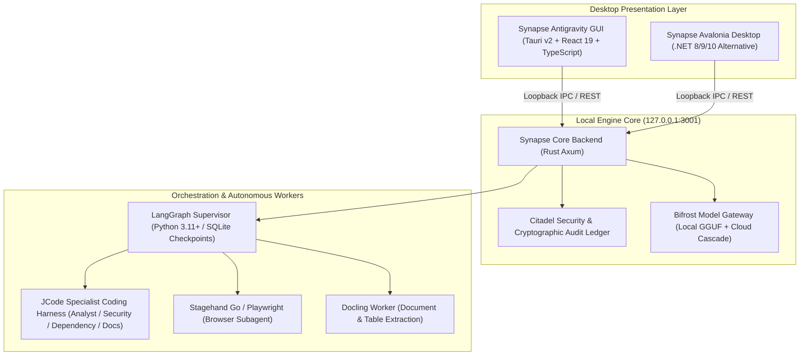

# Synapse AI Platform

> **Local-First Autonomous Multi-Agent Desktop Platform & Neural Developer Workspace**

Synapse is an AI-first software engineering and orchestration environment. Built on a deterministic, loopback-isolated core, Synapse combines a modern desktop client designed around Google Antigravity aesthetics with multi-agent orchestration, specialist coding engines, and a cryptographic security audit ledger.

---

## Architecture Overview



---

## Key Capabilities

### 1. Antigravity Desktop Interface (`desktop-tauri/`)
* **Frameless Native Chrome**: Drag regions with dedicated Windows caption buttons (`-`, `[ ]`, `[x]`) connected through native Rust IPC.
* **Real-Time Execution Graph**: First-class sidebar menu rendering live Mermaid diagrams (`flowchart LR` state machine and `sequenceDiagram` lifecycle) with event count metrics and cryptographic verification tags.
* **Fluid Conversation Physics**: Spring-curve message reveals (`cubic-bezier(0.16, 1, 0.3, 1)`), expandable Antigravity reasoning trace pills (`Thought for 2s >`), and iridescent composer border halos.
* **Custom Dropdown System**: Model selector with provider health badges, offline detection, and fallback alerts.
* **Collapsible Inspector Dock**: Live status of active subagents, background tasks, and generated artifacts.

### 2. Citadel Security Engine & Confinement
* **Strict Loopback Binding**: All daemon endpoints are locked to `127.0.0.1` and require an authenticated session token (`X-Synapse-Token`).
* **Cryptographic Audit Ledger**: Append-only SHA-256 hash chain recording every tool dispatch, file change, and network probe.
* **Human-in-the-Loop (HITL) Authorization**: Dangerous or external actions require explicit operator approval through execution gates before evaluation.
* **Filesystem Confinement**: Path canonicalization prevents directory traversal attacks outside the designated workspace.

### 3. Bifrost Inference Gateway
* **Local Offline Inference**: Native execution of GGUF open-weight models via local llama-server or Ollama with DirectML GPU acceleration.
* **Cloud Fallback Cascade**: High-availability routing across cloud providers (Google Studio Gemini, Groq, Cerebras, DeepSeek) when configured via API keys.
* **Deterministic Provider Reporting**: If a selected model or provider is not configured or offline, the interface directly reports the status without synthetic hallucination.

### 4. Specialist Autonomous Workers
* **JCode Specialist Coding Harness**: Sandboxed roles for codebase architecture analysis, security scanning, dependency parity checking, and automated documentation generation.
* **Stagehand Go / Playwright**: Autonomous web browsing subagent with sandboxed DOM perception and screenshot verification.
* **Docling Document Worker**: Ingestion and structured table parsing of PDF and DOCX files into clean Markdown.

---

## Directory Layout

```
synapse/
 desktop-tauri/               # Modern Tauri v2 + React 19 + TypeScript GUI
    src/                     # React components (AgentView, GraphView, MermaidGraph)
    src-tauri/               # Tauri v2 Rust core and window commands
 desktop-avalonia/            # Cross-platform Avalonia C# desktop client
 desktop-avalonia-backup/     # Preserved backup of Avalonia implementation
 backend-rust/                # Core Axum backend, Citadel ledger, Bifrost gateway
    src/routes/              # Endpoints (agent, auth, models, tools, memory)
    src/services/            # JCode manager, model gateway, audit services
 orchestral-runtime/          # LangGraph supervisor, Kali tools, worker services
 benchmarks/                  # Runtime performance and latency benchmarks
 run-tauri.bat                # Automated launcher for Tauri GUI & Rust backend
 run.bat                      # Automated launcher for Avalonia client & Rust backend
 .gitignore                   # Comprehensive repository ignore rules
```

---

## Getting Started

### Prerequisites

* **Rust & Cargo** (v1.75+): [https://rustup.rs/](https://rustup.rs/)
* **Node.js** (v18+ recommended): [https://nodejs.org/](https://nodejs.org/)
* **Python** (v3.11+): For orchestral runtime and document worker
* **.NET SDK** (8.0, 9.0, or 10.0): Optional, only required if running Avalonia desktop

### Quick Launch

To launch the Synapse Core Backend and the Tauri Antigravity Desktop Client together:

```cmd
.\run-tauri.bat
```

To run the Avalonia desktop client:

```cmd
.\run.bat
```

### Manual Development

#### 1. Start the Rust Backend
```cmd
cd backend-rust
cargo run
```
Backend will start on `http://127.0.0.1:3001`.

#### 2. Start the Tauri Desktop Client
```cmd
cd desktop-tauri
npm.cmd install
npm.cmd run tauri dev
```

#### 3. Build Production Executable
```cmd
cd desktop-tauri
npm.cmd run tauri build
```

---

## Configuration

Synapse operates 100% offline by default using local models. To enable optional cloud reasoning providers, copy `.env.example` in `backend-rust`:

```cmd
copy backend-rust\.env.example backend-rust\.env
```

Set the provider keys you wish to enable:
* `GEMINI_API_KEY`: Google Generative Language API
* `GROQ_API_KEY`: Groq Cloud LPU
* `CEREBRAS_API_KEY`: Cerebras Inference Engine
* `DEEPSEEK_API_KEY`: DeepSeek / SiliconFlow API

---

## Verification & Tests

Run Rust backend unit and integration tests:
```cmd
cargo test --manifest-path backend-rust/Cargo.toml
```

Verify Tauri frontend build:
```cmd
cd desktop-tauri && npm.cmd run build
```

Verify Tauri Rust crate:
```cmd
cargo check --manifest-path desktop-tauri/src-tauri/Cargo.toml
```

---

## Security Policy

See [SECURITY.md](SECURITY.md) for vulnerability reporting and security architecture details. All runtime operations are strictly sandboxed and logged to the Citadel ledger.

---

## License

This project is licensed under the MIT License.
